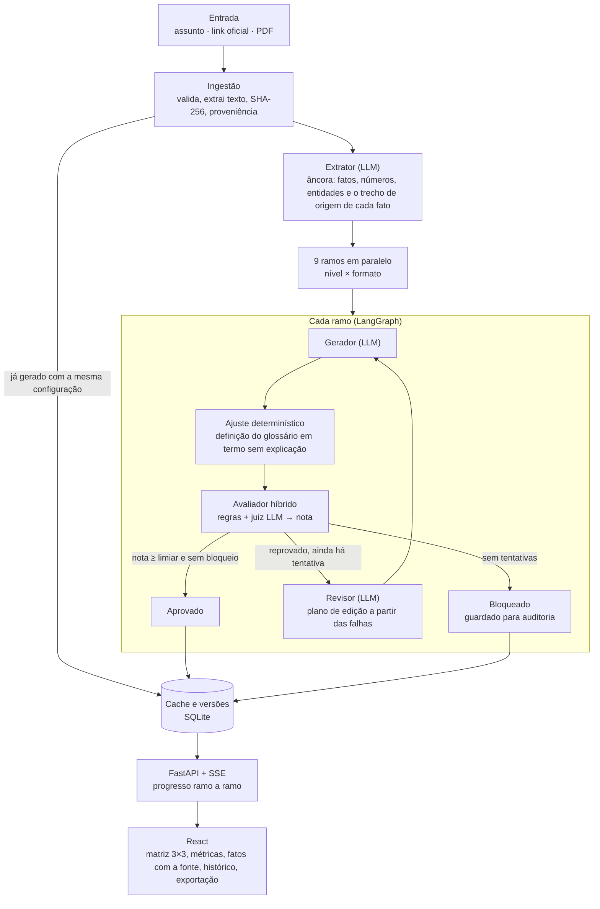

# Suno Content

Sistema baseado em grafos que recebe documentos financeiros públicos e densos (atas do Copom, relatórios do Banco Central,
normas da CVM, releases) e gera **9 conteúdos**: 3 níveis de leitor (iniciante, intermediário e avançado) × 3 formatos
(artigo analítico, carrossel e roteiro de vídeo de até 60 s). Nada é publicado sem passar por um **avaliador híbrido**,
que mede com métricas determinísticas se o texto respeita o nível e os fatos do documento, consulta um juiz LLM de outra
família de modelo e devolve o texto para reescrita (reflection loop) quando a nota fica abaixo do limiar do nível.

> Case Setembro · Academy × Finance.

## Sumário

1. [Entregáveis do case](#entregáveis-do-case)
2. [Diferenciais](#diferenciais)
3. [Arquitetura](#arquitetura)
4. [Níveis e formatos](#níveis-e-formatos)
5. [Metodologia de avaliação](#metodologia-de-avaliação)
6. [Reflection loop](#reflection-loop)
7. [Resultados](#resultados)
8. [Custo, latência e trade-offs](#custo-latência-e-trade-offs)
9. [Limitações](#limitações)
10. [Como reproduzir](#como-reproduzir)
11. [Estrutura do repositório](#estrutura-do-repositório)
12. [Trabalhos futuros](#trabalhos-futuros)

## Entregáveis do case

| Entregável | Onde está |
|---|---|
| 1. Pipeline de adaptação estruturada | Grafo em LangGraph: [geracao/grafo.py](geracao/grafo.py) e [geracao/ramo.py](geracao/ramo.py) |
| 2. Suíte de avaliação híbrida | [avaliador/](avaliador/) e os testes em [tests/](tests/) (pytest) e [frontend/src](frontend/src) (vitest) |
| 3. Reflection loop | Nó de reescrita com relatório de falhas e nota numérica: [geracao/ramo.py](geracao/ramo.py), [geracao/revisor.py](geracao/revisor.py) |
| 4. Interface e dashboard | FastAPI ([api/main.py](api/main.py)) + React ([frontend/](frontend/)) |
| 5. Vídeo demonstrativo | Entregue à parte |
| 6. Relatório experimental | Este README ([Resultados](#resultados)), gerado por [scripts/experimento.py](scripts/experimento.py) |

## Diferenciais

O que o projeto entrega além do que o case pede.

### Na interface

- **Três jeitos de entrar com o documento:** um assunto (com sugestões clicáveis, como Copom, Selic, IPCA e Câmbio, que
  levam ao documento oficial mais recente), um link de fonte oficial ou um PDF enviado.
- **Histórico em abas por tipo de entrada:** termos, links e PDFs separados, cada aba com a contagem; qualquer geração
  anterior abre com um clique.
- **Termos técnicos destacados:** os termos do glossário aparecem marcados no texto, em tons de vermelho por nível
  (vocabulário de mercado ou jargão de especialista), e mostram o significado ao passar o mouse. Um interruptor tira a
  marcação para ler o texto limpo.
- **Gráficos no carrossel:** uma caixinha liga gráficos de barras ou de linha nos slides, feitos só com números do
  documento e conferidos pelo avaliador como qualquer número do texto.
- **Slides prontos para postar:** imagens 1080 × 1080 com a logo e a identidade da Suno, em PNG e SVG, mais uma folha
  única que o Figma importa. O texto é medido na largura real da fonte e nunca sai da imagem.
- **Escolha do que gerar:** níveis e formatos marcáveis, para gerar só o que interessa, e mais rápido.
- **Matriz 3 × 3 com mapa de calor:** os 9 conteúdos de uma vez, em verde mais forte quando aprovaram com menos
  tentativas, e o progresso de cada um em tempo real enquanto o grafo trabalha.
- **Por que não foi publicado:** quando um conteúdo é bloqueado, a tela explica cada problema em linguagem simples, do
  mais grave para o mais leve, com uma sugestão de como melhorar.
- **O caminho do reflection loop à vista:** a nota de cada tentativa, o plano do revisor e a diferença entre a primeira
  e a última versão, com o que saiu riscado e o que entrou sublinhado.
- **Fatos com a fonte:** cada fato usado no conteúdo mostra o trecho do documento de onde saiu.
- **Comparar versões:** escolhe outra geração do mesmo documento e mostra o que mudou entre as duas.
- **Mais exportações:** roteiro em planilha e texto, artigo em HTML, Markdown e texto, e prompt para IA de imagem com aviso
  de que imagens geradas fora do sistema não passaram pelo avaliador.
- **Modo claro e escuro**, acompanhando o sistema, e layout que funciona no celular.

### Na avaliação e no pipeline

- **Anti-trivialização medida:** a cobertura dos fatos e a conferência de cada número impedem que o texto passe só
  encurtando.
- **Juiz de outra família que só pode baixar a nota:** o gerador é Google e o juiz é OpenAI; a aprovação vem das regras
  determinísticas, e o juiz não aprova o que elas reprovam.
- **Nota com bloqueios e piso:** número fora do documento, recomendação de investimento, vídeo acima de 60 s e
  fidelidade baixa reprovam com qualquer nota.
- **Glossário fundamentado:** o nível de cada um dos 315 termos segue um critério verificável (ter ou não verbete em
  glossários abertos para leigos).
- **Cache compartilhado e versões:** um pedido repetido volta em cerca de 1 s; nada é sobrescrito, e cada versão guarda
  o modelo, o prompt, o glossário e os limiares usados. Reprovadas ficam guardadas para auditoria.
- **Retry por ramo:** só o conteúdo reprovado é refeito, não os 9.
- **Fontes oficiais e privacidade:** só domínios permitidos, com hash e data de cada documento; PDF enviado fica só na
  sessão de quem enviou.
- **Monitor das fontes:** detecta documentos novos e gera antes de alguém pedir; se a API do Banco Central cair, usa a
  última ata conhecida.
- **Mais de 400 testes automatizados** (pytest e vitest) que rodam sem chamar nenhum modelo.

## Arquitetura



**Agentes com LLM:** extrator (uma vez por documento), gerador (um agente parametrizado por nível e formato), revisor
(só quando reprova) e juiz (fidelidade e rubrica do nível). Todo o resto é determinístico: métricas, nota, roteamento,
contador de tentativas e cache.

| Papel | Modelo | Por quê |
|---|---|---|
| Extrator | Groq `openai/gpt-oss-120b` | Saída estruturada estrita, sem custo de API |
| Gerador e revisor | Google `gemini-3.5-flash-lite` | Plano gratuito, rápido e com bom português |
| Juiz | Groq `openai/gpt-oss-120b` | **Família diferente da do gerador** (OpenAI × Google), para reduzir o viés de autoaprovação |
| Classificador cego (experimentos) | Groq `openai/gpt-oss-20b` | Limite de tokens separado do extrator e do juiz |

**Entradas:** assunto (um termo é mapeado para a fonte oficial mais recente em [dados/ingestao.yaml](dados/ingestao.yaml)),
link de domínio permitido (BCB, CVM, Tesouro, B3, RI das empresas) ou PDF enviado (fica visível só na sessão de quem
enviou). Cada documento tem proveniência registrada (origem, data e hash), e todo fato mostra o trecho do documento de
onde saiu.

## Níveis e formatos

As definições vêm do case e viram regras que o avaliador consegue verificar:

| | Iniciante | Intermediário | Avançado |
|---|---|---|---|
| Termo do glossário de nível 3 (jargão institucional) | Proibido | Só com explicação | Livre |
| Termo de nível 2 (vocabulário de mercado) | Só com explicação | Livre | Livre |
| Legibilidade (Flesch PT-BR) | 60 a 100 | 40 a 60 | 0 a 50 |
| Densidade mínima de termos de nível 2 e 3 | — | — | 1,0 por 100 palavras |
| Cobertura dos fatos da âncora | ≥ 80% | ≥ 80% | ≥ 90% |
| Números | Todos existem no documento | Idem | Idem |
| Recomendação de investimento | Nenhuma | Nenhuma | Nenhuma |
| Rubrica do juiz | Analogia do dia a dia; impacto no bolso | Vocabulário de mercado; alocação e tendências | Jargão preservado; implicação analítica |

**Formatos:** artigo de 250 a 900 palavras; carrossel de 5 a 10 slides com até 220 caracteres cada (gancho, corpo e
conclusão), com gráficos opcionais de barras ou linha feitos só com números dos fatos; roteiro com fala, visual e
marcação de tempo calculada pelo tamanho da fala, com no máximo 60 s.

## Metodologia de avaliação

O avaliador é o núcleo do projeto. Ele combina métricas determinísticas, que dão o teto da nota, com um juiz LLM, que
só pode baixá-la. Tudo fica em [avaliador/](avaliador/) e os limiares em [dados/avaliacao.yaml](dados/avaliacao.yaml).

### Métricas determinísticas

| Métrica | Como mede | Arquivo |
|---|---|---|
| **Legibilidade** | Flesch Reading Ease adaptado ao português (Martins et al., 1996): `248,835 − 1,015 × palavras/sentença − 84,6 × sílabas/palavra`, com sílabas pelo Pyphen (`pt_BR`). No carrossel, cada slide é uma sentença; no vídeo, só a fala conta | [legibilidade.py](avaliador/legibilidade.py) |
| **Densidade e contextualização de termos** (Domain Term Density) | Glossário próprio com 315 termos (82 de nível 1, 156 de nível 2 e 77 de nível 3) e suas variantes. Um termo conta como explicado quando vem com marcador ("ou seja", "que é", parênteses, travessão) na mesma frase ou na anterior | [glossario.py](avaliador/glossario.py), [dados/glossario.yaml](dados/glossario.yaml) |
| **Cobertura da âncora** (anti-trivialização) | Fração dos fatos centrais do documento que continuam no texto, pelos números e entidades de cada fato | [ancora.py](avaliador/ancora.py) |
| **Números** (factuality checker) | Todo número do texto e dos gráficos precisa existir nos fatos ou no trecho de origem; só o iniciante pode arredondar, e só com "cerca de" ou "quase" | [ancora.py](avaliador/ancora.py) |
| **Linguagem de recomendação** | 9 padrões ("compre", "vale a pena investir", "é hora de vender", "retorno garantido"...) | [recomendacao.py](avaliador/recomendacao.py) |
| **Limites de formato** | Palavras, slides, caracteres por slide, duração do vídeo e limites dos gráficos | [formatos.py](avaliador/formatos.py) |

**Por que o glossário separa os níveis:** o nível 2 é o vocabulário com verbete em glossários abertos para leigos
(Banco Central, B3, CVM), como Selic, IPCA e CDI. O nível 3 é o jargão de atas e relatórios que **não** tem verbete
nesses glossários, como hiato do produto, forward guidance e balanço de riscos. A frequência no corpus não separa os
níveis: "hiato do produto" aparece em 65 dos 155 documentos e mesmo assim é jargão. Um teste garante que os termos
citados no case continuem nos níveis certos.

### Juiz LLM

O juiz ([juiz.py](avaliador/juiz.py)) recebe o texto, a âncora e a rubrica do nível e devolve uma saída estruturada:
afirmações sem suporte nos fatos, nota de fidelidade (1 a 5), itens da rubrica atendidos e não atendidos e nota de
adequação ao nível (1 a 5).

### Nota contra o limiar

Cada métrica vira uma nota de 0 a 1, e a média ponderada precisa alcançar o limiar do nível ([pontuacao.py](avaliador/pontuacao.py)):

| Legibilidade | Glossário | Cobertura | Formato | Rubrica | Fidelidade | Limiar |
|---|---|---|---|---|---|---|
| 0,20 | 0,20 | 0,20 | 0,10 | 0,20 | 0,10 | 0,85 |

- **Bloqueios:** reprovam com qualquer nota, porque não podem ir ao ar em ambiente regulado. São eles: número fora do
  documento, recomendação de investimento, vídeo acima de 60 s e fidelidade abaixo de 4 no juiz.
- **Piso por métrica:** a média não esconde um defeito grave. Um texto de nível errado com legibilidade 0,28 não passa
  só porque o resto está bom.
- **Juiz só quando importa:** se as regras já deixam a nota abaixo do limiar, o juiz não é chamado. Isso economiza
  chamadas e não muda o resultado.

### Como isso responde aos dois problemas do case

- **Resumo por encurtamento:** a cobertura da âncora impede passar na legibilidade só cortando conteúdo, e os números
  são conferidos um a um. No avançado, a densidade mínima de termos impede simplificar demais.
- **Avaliação subjetiva:** a aprovação depende de métricas determinísticas e reproduzíveis. O juiz é de outra família,
  responde com rubrica estruturada (itens copiados literalmente, não uma nota livre) e só pode baixar a nota. Por isso o
  viés de extensão do juiz não aprova um texto que as regras reprovam.

## Reflection loop

Cada um dos 9 ramos é independente, com até **2 tentativas** ([ramo.py](geracao/ramo.py)):

1. O gerador escreve, e um ajuste determinístico acrescenta a definição do glossário a termos que vieram sem explicação.
2. O avaliador calcula a nota. Se reprovar, monta um **relatório de falhas com feedback numérico**: a nota e o mínimo,
   as métricas abaixo de 1, os bloqueios e uma orientação por falha (por exemplo, "Flesch 46,6 fora da faixa 60 a 100:
   frases mais curtas, mire perto de 80" ou "faltam os fatos f2 e f4, com estes números").
3. O revisor transforma as falhas num plano de edição, e o gerador reescreve com esse plano e a versão anterior.
4. Se ainda reprovar, o ramo é bloqueado: fica guardado para auditoria e não aparece como publicado.

Só o ramo reprovado é refeito. A interface mostra o caminho de cada conteúdo (tentativas, nota de cada uma, plano do
revisor e diferença entre a primeira e a última versão) e, quando o conteúdo é bloqueado, o motivo em linguagem simples
com uma sugestão de melhoria.

## Resultados

Gerados por [scripts/experimento.py](scripts/experimento.py) sobre as gerações guardadas no banco
(`python scripts/experimento.py relatorio --salvar resultados.md` gera o relatório completo).

**Recorte:** só as gerações feitas depois da nota contra o limiar (commit `0855528`, 16/10/2026): **8 gerações, 60
conteúdos, 4 documentos** (ata do Copom, Relatório de Política Monetária, Relatório de Estabilidade Financeira e um PDF
enviado). Antes disso, o avaliador reprovava por qualquer falha isolada, e as gerações não representam o sistema atual.

### Matriz de confusão dos níveis

Linhas: nível pedido. Colunas: nível que o classificador identificou lendo só o texto, sem saber o nível pedido.

Classificador por regras (glossário + Flesch), que identifica o nível mais baixo cujas regras o texto respeita.

**Antes do loop** (primeira tentativa de cada conteúdo):

| real \ previsto | iniciante | intermediário | avançado |
|---|---|---|---|
| **iniciante** | 18 | 1 | 1 |
| **intermediário** | 0 | 20 | 0 |
| **avançado** | 0 | 0 | 20 |

Acurácia: **97%** em 60 textos.

**Depois do loop** (versão final de cada conteúdo):

| real \ previsto | iniciante | intermediário | avançado |
|---|---|---|---|
| **iniciante** | 19 | 1 | 0 |
| **intermediário** | 0 | 20 | 0 |
| **avançado** | 0 | 1 | 19 |

Acurácia: **97%** em 60 textos. Por formato: artigo 100%, carrossel 96%, vídeo 94%.

**Só os aprovados** (versão final):

| real \ previsto | iniciante | intermediário | avançado |
|---|---|---|---|
| **iniciante** | 15 | 1 | 0 |
| **intermediário** | 0 | 14 | 0 |
| **avançado** | 0 | 0 | 17 |

Acurácia: **98%** em 47 textos.

**Como ler:** os textos já saem no nível certo na primeira tentativa, então a matriz quase não muda com o loop; o
ganho do loop aparece na aprovação (seção abaixo). Esse classificador usa as mesmas regras do avaliador, então a
acurácia alta é em parte esperada: ela mostra que os textos cumprem as regras de cada nível. Uma medida independente,
com um classificador LLM que não conhece as regras, fica em [trabalhos futuros](#trabalhos-futuros) (o script já faz:
`python scripts/experimento.py relatorio --llm`).

### Legibilidade por nível

Flesch médio da versão final: **iniciante 75,2 · intermediário 51,4 · avançado 36,4**. Os níveis ficam separados e na
ordem esperada.

### Convergência

| | Conteúdos | Aprovados | De primeira | Recuperados pelo loop | Tentativas (média) |
|---|---|---|---|---|---|
| **Total** | 60 | 47 (78%) | 57% | 13 | 1,5 |
| Iniciante | 20 | 16 (80%) | 65% | 3 | 1,4 |
| Intermediário | 20 | 14 (70%) | 50% | 4 | 1,5 |
| Avançado | 20 | 17 (85%) | 55% | 6 | 1,6 |
| Artigo | 18 | 16 (89%) | 61% | 5 | 1,5 |
| Carrossel | 24 | 19 (79%) | 62% | 4 | 1,4 |
| Vídeo | 18 | 12 (67%) | 44% | 4 | 1,6 |

O loop recupera 13 dos 60 conteúdos (22%). Antes do ajuste da nota, com todas as 29 gerações, a aprovação era de 52%,
e só 30% passavam de primeira.

## Custo, latência e trade-offs

- **Custo:** todos os modelos estão em planos gratuitos (Groq e Gemini). Um documento usa em média 2,8 chamadas de LLM
  por conteúdo, somando geração, juiz e revisor, mais uma extração.
- **Latência:** com 9 conteúdos, uma ata do Copom (6 páginas) levou de 2 a 8 minutos nas gerações registradas;
  relatórios de 90 a 110 páginas levaram de 7 a 15 minutos, com casos acima de 1 hora em horários de limite estourado. O gargalo é o limite de tokens por minuto dos planos gratuitos: quando a API recusa, o juiz espera e
  tenta de novo, e isso domina o tempo.
- **Cache:** gerar uma vez e servir muitas. Um pedido igual (mesmo documento e mesma configuração) volta em cerca de
  1 s, sem chamar modelo. A chave inclui o hash do código, dos prompts, do glossário e dos limiares, então qualquer
  mudança no sistema gera uma versão nova, e nada é sobrescrito.
- **2 tentativas por ramo:** cada tentativa a mais soma geração, avaliação e juiz, e o tempo já é limitado pelos planos
  gratuitos. Em vez de mais tentativas, os prompts foram ajustados para acertar na primeira (57% aprovam de primeira) e
  a reescrita recebe um plano do revisor.
- **Juiz só quando pode mudar o resultado:** se as regras já reprovam, a chamada é poupada.
- **Menos fatos nos formatos curtos:** o carrossel recebe 6 fatos e o vídeo 4. Em 60 s não cabem 12 fatos com contexto,
  e cobrar tudo reprovava sem ter como corrigir.
- **Modelos separados por limite:** a Groq limita tokens por minuto por modelo, então o classificador dos experimentos
  usa um modelo diferente do extrator e do juiz.

## Limitações

- **Amostra pequena:** os resultados atuais vêm de 60 conteúdos de 4 documentos. Os números servem para comparar
  configurações do sistema, não como estimativa precisa.
- **Faixas de Flesch do iniciante e do intermediário são hipóteses:** o corpus só tem textos técnicos (até o glossário
  leigo do BC tem mediana 41), então essas faixas não puderam ser calibradas com textos de referência. O que garante o
  nível é, antes de tudo, a regra de termos do glossário; o Flesch é um apoio. A faixa do avançado foi calibrada com
  [scripts/calibra.py](scripts/calibra.py): atas, relatórios e normas têm Flesch mediano entre 30 e 45 por parágrafo, e
  a faixa passou de 0 a 40 para 0 a 50.
- **Definição colada:** o ajuste automático de termos garante a explicação, mas pode deixar a frase mecânica ("X, que é
  ..."). A interface avisa quando isso acontece.
- **O juiz não vê os gráficos:** os números deles são conferidos pelas regras, mas a fidelidade semântica é julgada só
  sobre o texto.
- **Dependência das fontes:** a lista de atas do Copom vem de uma API do Banco Central que às vezes sai do ar. Quando
  isso acontece, o sistema usa a última ata conhecida.

## Como reproduzir

Requisitos: Python 3.12 ou superior (testado com 3.14) e Node.js 18 ou superior.

```bash
# 1. Dependências
pip install -r requirements.txt
cd frontend && npm install && cd ..

# 2. Chaves (gratuitas): GROQ_API_KEY e GEMINI_API_KEY
cp .env.example .env        # e preencha

# 3. Corpus (opcional: só para experimentos e calibração; a interface baixa o documento sozinha)
python scripts/baixa_corpus.py
python scripts/extrai_texto.py

# 4. Interface: compile o front e suba a API, que serve os dois em http://127.0.0.1:8000
cd frontend && npm run build && cd ..
python -m uvicorn api.main:app --port 8000
#    Para desenvolver o front com recarga automática: npm run dev em frontend/ (porta 5173)

# 5. Testes
python -m pytest -q          # backend: avaliador, ingestão, grafo, API e armazenamento
cd frontend && npm test      # frontend: componentes, encaixe dos slides e exportação

# 6. Experimentos
python scripts/experimento.py gerar                                   # gera os documentos padrão do corpus
python scripts/experimento.py relatorio --llm --salvar resultados.md

# 7. Monitor das fontes oficiais (gera o que for novo)
python scripts/monitor.py --so-listar
```

Os testes não chamam nenhum modelo: usam extrator, gerador e juiz falsos. Por isso rodam sem chave e dão sempre o
mesmo resultado.

## Estrutura do repositório

```
api/            FastAPI: jobs com progresso em SSE, histórico, configuração
avaliador/      métricas determinísticas, juiz, nota, classificador cego
geracao/        grafo, ramo (gerar, avaliar, revisar), prompts, schemas, ajuste de termos
ingestao/       adaptadores de PDF, link e termo; extrator da âncora
armazenamento/  banco (SQLite via SQLAlchemy), cache, versões, monitor, relatórios
dados/          glossário, limiares do avaliador, fontes permitidas, lista do corpus
frontend/       React + Vite + TypeScript
scripts/        corpus, calibração, experimentos, monitor e utilitários
tests/          suíte do backend (pytest)
```

## Trabalhos futuros

**Produto**

- **Login e perfil do leitor:** guardar, com consentimento, o nível e os assuntos de cada pessoa, para abrir direto no
  nível dela e manter o histórico entre dispositivos (hoje os PDFs enviados ficam só no navegador de quem enviou).
- **Entender o que o público pede:** registrar de forma agregada e anônima quais níveis, formatos e assuntos são mais
  pedidos e lidos, para priorizar a geração (por exemplo, gerar primeiro o nível mais procurado) e orientar a equipe de
  conteúdo da Suno.
- **Conteúdos mais detalhados:** artigos mais longos e aprofundados para o avançado, séries de carrosséis sobre um mesmo
  documento, glossário interativo ao lado do texto e comparação entre documentos (por exemplo, o que mudou de uma ata
  do Copom para a seguinte).
- **Mais fontes:** releases de resultados e fatos relevantes de empresas (B3, CVM), com atualização automática pelo
  monitor.
- **Integração direta com ferramentas de edição:** hoje o carrossel sai como SVG que o Figma importa e o roteiro como
  planilha. O próximo passo é enviar direto para o Figma (pela API, preenchendo um template da Suno), Canva ou editores
  de vídeo, para o designer ajustar a arte final sem copiar e colar, e com o texto aprovado travado contra edições que
  mudem números.
- **Integração com os canais de publicação da Suno**, mantendo o avaliador como portão antes de qualquer publicação.

**Modelos**

- **Modelos pagos e mais capazes:** trocar o gerador gratuito por um modelo maior (por exemplo, Claude Sonnet ou Gemini
  Pro) tende a aumentar a aprovação de primeira e a qualidade do texto, principalmente nos níveis iniciante e avançado.
  Planos pagos também tiram o limite de tokens por minuto, que hoje domina a latência.
- **Comparar configurações:** medir custo, latência e aprovação de cada combinação de gerador e juiz com o mesmo
  corpus, aproveitando que cada versão já registra modelo, prompt e glossário usados.

**Avaliação**

- Classificador cego por LLM sobre todas as tentativas, com mais documentos, para uma matriz de confusão independente e
  com mais amostra (`python scripts/experimento.py relatorio --llm`).
- Calibrar as faixas de Flesch do iniciante e do intermediário com textos de referência escritos para leigos.
- Cobertura diferente por nível: o iniciante precisa das ideias centrais, não de todos os números do documento.
- Validação com leitores reais de cada nível, para confirmar que as métricas acompanham a percepção do público.
