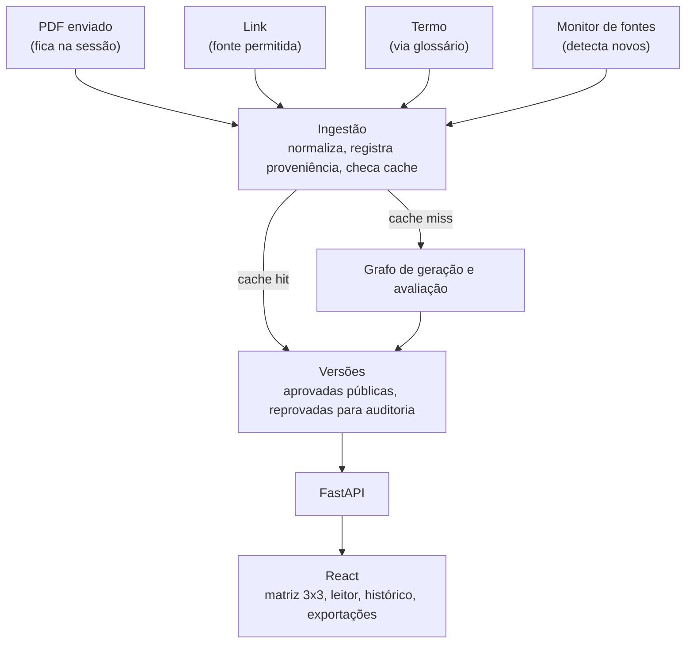
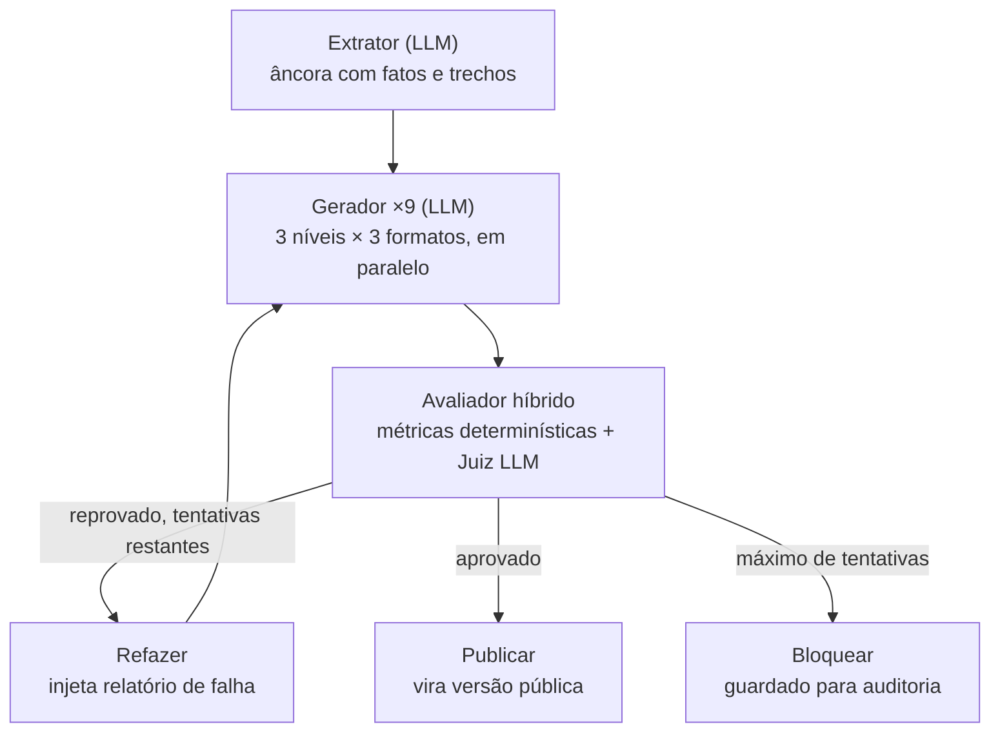
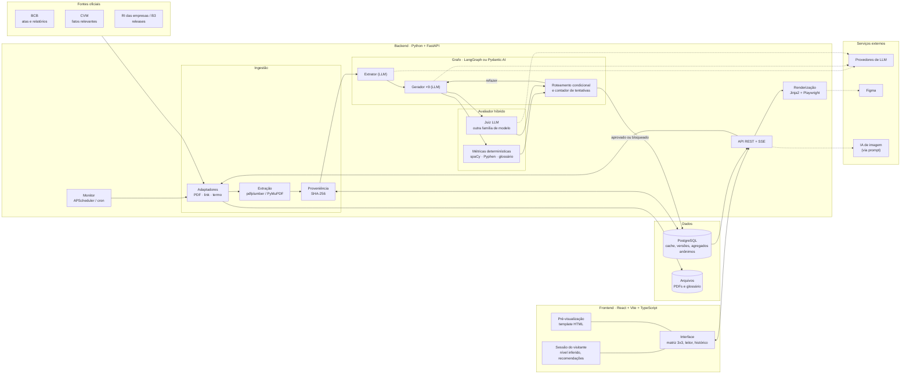
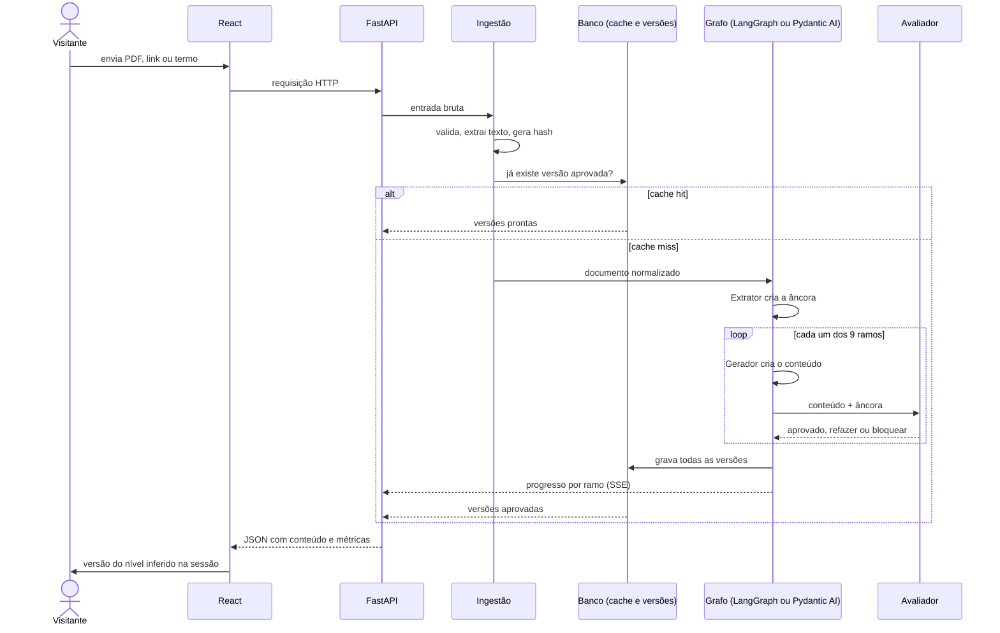

# Suno Content: Plano do Projeto

> Case Setembro · Academy x Finance
> Pipeline de adaptação de documentos financeiros com avaliação híbrida, determinística e baseada em dados.

Este documento registra as decisões de produto e arquitetura e o roteiro de construção.

---

## 1. Visão do produto

Um site aberto que recebe documentos financeiros por três portas (PDF, link de fonte permitida ou termo), gera **9 versões** (3 níveis × 3 formatos), valida tudo com um **avaliador híbrido** e entrega a cada visitante a versão do nível dele, inferido pelo comportamento na sessão.

Resultados de fontes oficiais são compartilhados entre todos os visitantes, sem login, atualizados automaticamente quando surge um documento novo, e todas as versões aprovadas ficam disponíveis num histórico.

**Níveis:** Iniciante · Intermediário · Avançado
**Formatos:** Artigo analítico · Carrossel · Roteiro de vídeo curto (até 60s)

---

## 2. Arquitetura

### 2.1 Visão geral

O sistema é organizado em cinco camadas:

1. **Entrada:** três portas para o visitante (PDF, link, termo) e um monitor automático que verifica as fontes oficiais periodicamente.
2. **Ingestão:** transforma qualquer entrada num documento normalizado com proveniência e decide se é preciso gerar ou se já existe resultado.
3. **Grafo:** extrai, gera, avalia e corrige.
4. **Versões:** guarda todas as gerações, sem substituição.
5. **Interface:** expõe o grafo e as versões; a sessão do visitante (nível inferido e recomendações) vive só aqui.

### 2.2 Camada de ingestão

Cada porta tem um adaptador próprio, mas todos produzem o mesmo **documento normalizado** (texto, metadados e proveniência). A partir daí, o fluxo é único.

| Porta | Validação | Proveniência | Visibilidade do resultado |
|---|---|---|---|
| PDF | Limites de tamanho e páginas; checagem "é documento financeiro?" | Enviado pelo usuário | Só na sessão |
| Link | Apenas domínios permitidos | URL oficial | Pública |
| Termo | Normalização via glossário e entidades | Catálogo ou fonte oficial | Pública |
| Monitor | Fontes da lista permitida | URL oficial | Pública |

Etapas da ingestão:

1. Receber a entrada pelo adaptador correspondente.
2. Validar (domínio, tamanho, tipo de documento).
3. Extrair o texto, com atenção especial a tabelas em PDFs de releases.
4. Registrar proveniência: URL ou origem, data da coleta e hash do arquivo.
5. Consultar o cache pela chave do documento ou do termo normalizado.
6. Se já processado, servir as versões existentes; se não, enviar ao grafo.

**Fontes permitidas:** Banco Central (atas do Copom, relatórios), CVM (fatos relevantes via dados abertos), sites de RI das empresas e B3.

### 2.3 Grafo de geração e avaliação

**Agentes com LLM (mínimo necessário):**

- **Extrator:** lê o documento e produz a âncora (fatos, números, entidades e o trecho de origem de cada um). Roda uma vez por documento. A âncora é a referência de verdade para o avaliador.
- **Gerador:** um único agente parametrizado por nível e formato, executado 9 vezes em paralelo. No refinement loop, é o mesmo agente rodando de novo com o relatório de falha no contexto.
- **Juiz:** avalia o que não é mensurável deterministicamente, principalmente fidelidade semântica. Usa um modelo de outra família para reduzir viés de autoaprovação.

**Componentes determinísticos (sem LLM):** métricas de avaliação, roteamento condicional e controle de tentativas.

**Regras do loop:**

- Cada um dos 9 ramos é independente, com seu próprio contador de tentativas; só o ramo reprovado é refeito.
- O ramo do nível do visitante é priorizado.
- Conteúdo que não converge não é publicado.
- A âncora chega ao avaliador pelo estado compartilhado do grafo.

### 2.4 Avaliador híbrido

| Métrica | Tipo | O que verifica |
|---|---|---|
| Legibilidade | Determinística | Índice adaptado ao português dentro da faixa do nível |
| Densidade de termos | Determinística | Termos do glossário acima do nível aparecem sem explicação? |
| Limites de formato | Determinística | Caracteres por slide, duração do roteiro, estrutura obrigatória |
| Cobertura da âncora | Determinística | Os fatos centrais continuam presentes (anti-trivialização) |
| Números | Determinística | Valores citados batem com a âncora |
| Linguagem de recomendação | Determinística | Ausência de frases de recomendação de investimento |
| Fidelidade semântica | Juiz LLM | Afirmações sustentadas pela âncora, com rubrica estruturada |

### 2.5 Versões e cache

- O cache é compartilhado entre visitantes, com chave pelo documento ou termo normalizado, nunca pelo visitante.
- Nada é substituído: toda geração vira uma versão, identificada por data, documento de origem e versões do modelo, do prompt e do glossário.
- A versão aprovada mais recente aparece por padrão; as anteriores ficam num histórico sinalizado como antigo.
- Versões reprovadas são guardadas só para auditoria e experimentos.
- Nada que identifique o visitante é armazenado.

### 2.6 Interface

- **Stack:** FastAPI no backend, React no frontend.
- Progresso do grafo em tempo real.
- Matriz de saídas 3x3 com mapa de calor de métricas.
- Pré-visualização do carrossel em tamanho real a partir de um **template HTML único**, que também gera PNG sob demanda e serve de base para as exportações.
- Termos do glossário destacados no texto e métricas ao lado de cada conteúdo.
- Antes e depois do refinement loop.
- Visão do leitor com nível inferido, data de geração e fonte visíveis.
- Seletor de nível (e de formato) sempre visível: o nível inferido é o padrão, e a escolha do visitante prevalece sobre a inferência.
- Navegação pelo histórico de versões.
- Exportações: Figma e prompt para IA de imagem, com aviso de que imagens geradas externamente não passaram pelo avaliador.

### 2.7 Personalização (só na sessão)

- Nível inferido por comportamento (cliques em termos, troca de nível).
- Recomendações baseadas nas entidades extraídas e em pesquisas em alta, agregadas e anônimas.
- Acesso ao perfil concentrado num único ponto do código, para facilitar persistência futura.

### 2.8 Conformidade

- Conteúdo educativo, nunca recomendação de investimento, com aviso visível.
- Data e documento de origem exibidos em todo conteúdo.
- Resultados de uploads não são compartilhados com outros visitantes.

---

## 3. Arquitetura técnica

Esta seção mostra os componentes do sistema com suas tecnologias e, em seguida, acompanha uma pesquisa do começo ao fim, mostrando por onde ela passa e qual tecnologia atua em cada etapa.

### Diagrama de arquitetura

As setas tracejadas indicam chamadas a serviços externos. O avaliador lê a âncora pelo estado compartilhado do grafo.

### Caminho de uma requisição

### 3.1 Visitante no React

O visitante digita um termo, cola um link ou envia um PDF na interface em **React (Vite + TypeScript)**. Enquanto navega, o próprio React guarda na sessão os sinais de comportamento (cliques em termos, trocas de nível) e calcula o nível inferido. Nada disso vai para o servidor. A requisição segue para a API.

### 3.2 FastAPI recebe e encaminha

A **FastAPI** recebe a entrada e identifica o tipo. Se for preciso gerar conteúdo, abre um canal de **Server-Sent Events** para o React acompanhar o progresso em tempo real, ramo por ramo.

### 3.3 Ingestão normaliza

O adaptador da porta correspondente entra em ação:

- **PDF:** checa limites e extrai texto e tabelas (**pdfplumber/PyMuPDF**).
- **Link:** confere se o domínio está na lista permitida e baixa o conteúdo (**httpx**, **BeautifulSoup** para páginas HTML).
- **Termo:** normaliza via glossário e procura no catálogo ou nas fontes oficiais.

O resultado é um documento normalizado, identificado por um hash **SHA-256** e com a proveniência registrada.

### 3.4 Consulta ao cache

Com o hash ou o termo normalizado, a ingestão consulta o **banco (PostgreSQL)**. Se já existe versão aprovada, ela volta direto para o React, sem nenhuma chamada a LLM. Se não existe, o documento segue para o grafo.

### 3.5 Grafo gera

No **grafo (LangGraph ou Pydantic AI, a decidir)**:

1. O **Extrator** (LLM) lê o documento e produz a âncora em **Pydantic**: fatos, números, entidades e trechos de origem.
2. O **Gerador** (LLM) é disparado 9 vezes em paralelo, uma para cada combinação de nível e formato, começando pelo nível do visitante. Cada saída é um JSON validado por Pydantic.

### 3.6 Avaliador decide

Cada saída passa pelo avaliador híbrido junto com a âncora:

- **Métricas determinísticas** em Python com **spaCy** (português) e **Pyphen**: legibilidade, densidade de termos do glossário, limites de formato, cobertura da âncora, números e linguagem de recomendação.
- **Juiz LLM**, de outra família de modelo, com rubrica estruturada, para a fidelidade semântica.

O roteamento condicional do grafo decide por ramo: **aprovado** segue para publicação; **reprovado com tentativas restantes** volta ao Gerador com o relatório de falha; **sem tentativas restantes** é bloqueado.

### 3.7 Gravação das versões

Todas as versões, aprovadas e reprovadas, são gravadas no banco com data, documento de origem e versões do modelo, prompt e glossário. Só as aprovadas ficam visíveis ao público; resultados de PDFs enviados ficam restritos à sessão de quem enviou.

### 3.8 De volta ao React

A FastAPI devolve o JSON com conteúdo e métricas. O React:

- Mostra a versão do nível inferido, com data e fonte, e um seletor com os três níveis. Trocar de nível ou de formato não chama LLM, porque as 9 versões já estão no cache. Enquanto o visitante não escolhe, vale o nível inferido; depois que escolhe, vale a escolha.
- Renderiza o carrossel a partir do **template HTML único** (o mesmo que o backend usa para gerar PNG com **Playwright** e para exportar ao Figma).
- Destaca os termos do glossário e exibe as métricas.
- Oferece a matriz 3x3, o histórico de versões e as exportações.

### 3.9 Fluxo paralelo: o monitor

Sem visitante envolvido, um agendador (**APScheduler** ou cron; comando manual na demo) verifica periodicamente as fontes oficiais. Ao encontrar um documento novo, ele entra pela ingestão e percorre o mesmo caminho a partir da etapa 3.3. Quando o próximo visitante pesquisar o tema, a versão nova já estará pronta.

---

## 4. Diferenciais

O que este projeto entrega além do que o case pede, e por que cada ponto importa.

### Rigor da avaliação

- **Métrica anti-trivialização.** A cobertura dos fatos da âncora impede que o refinement loop "passe" nas métricas de legibilidade simplesmente encurtando o texto, que é exatamente o problema que o case aponta.
- **Juiz de outra família de modelo.** Reduz o viés de autoaprovação de um modelo julgando o próprio texto.
- **Classificador cego para a matriz de confusão.** O nível é identificado sem saber qual foi pedido, e a matriz é gerada antes e depois do loop para provar numericamente o valor da correção.
- **Avaliação em integração contínua.** A suíte roda sobre um corpus fixo a cada push, então qualquer regressão aparece antes de chegar ao público.

### Confiabilidade e conformidade

- **Avaliador como portão de publicação.** Conteúdo que não converge não é publicado.
- **Detecção de linguagem de recomendação.** Mantém o conteúdo educativo, em linha com a regulação de recomendação de investimentos.
- **Fontes permitidas e proveniência.** Todo documento tem origem, data e hash registrados, e todo conteúdo exibe data e fonte.
- **Texto exibido é o texto avaliado.** Um template HTML único alimenta pré-visualização, PNG e Figma; nenhuma etapa reescreve o conteúdo depois da avaliação.

### Rastreabilidade

- **Histórico completo de versões.** Nada é substituído; cada versão registra modelo, prompt e glossário usados, o que permite separar o efeito de mudanças no documento do efeito de mudanças no sistema.
- **Reprovadas guardadas para auditoria.** Mostram onde o sistema erra e alimentam os experimentos.

### Eficiência

- **Gerar uma vez, servir muitas vezes.** O cache compartilhado faz com que mil leitores de uma mesma ata custem uma única geração.
- **Atualização automática.** O monitor detecta documentos novos nas fontes oficiais e gera o conteúdo antes que alguém peça.
- **Priorização do nível do visitante.** O ramo do nível inferido roda primeiro, e a pessoa lê enquanto os outros terminam. Como o visitante pode trocar de nível, os outros 8 ramos continuam obrigatórios.
- **Retry por ramo.** Só a combinação reprovada é refeita, não as 9.

### Experiência do leitor

- **Personalização por comportamento, sem login.** O nível é inferido na sessão, sem guardar nada que identifique a pessoa.
- **Recomendações sem dados pessoais.** Combinam as entidades extraídas com pesquisas em alta, agregadas e anônimas.
- **Termos destacados e explicados no nível certo.** O glossário serve ao avaliador e ao leitor ao mesmo tempo.

### Produção de conteúdo

- **Exportação para o Figma.** O designer continua no controle da arte final.
- **Prompt para IA de imagem.** Com aviso explícito de que imagens geradas externamente não passaram pelo avaliador.

---

## 5. Roteiro

### Fase 0: Fundamentos
- [x] 1. Definir os três níveis com regras mensuráveis
- [x] 2. Construir o glossário (nível mínimo de cada termo; também usado para normalizar termos)
- [x] 3. Montar o corpus fixo de 6 a 10 documentos variados
- [x] 4. Fechar stack e modelos (LangGraph ou Pydantic AI; modelo gerador; modelo juiz)

### Fase 1: Avaliador
- [x] 6. Métricas determinísticas: legibilidade, densidade de termos, limites de formato
- [ ] 7. Calibrar limiares com textos de referência
- [x] 8. Cobertura da âncora (anti-trivialização)
- [x] 9. Detecção de linguagem de recomendação
- [ ] 10. Juiz LLM com rubrica estruturada
- [ ] 11. Classificador cego da matriz de confusão

### Fase 2: Ingestão
- [ ] 12. Adaptador de PDF com limites e checagem de documento financeiro
- [ ] 13. Adaptador de link restrito aos domínios permitidos
- [ ] 14. Adaptador de termo com normalização
- [ ] 15. Registro de proveniência (URL, data, hash)
- [ ] 16. Schema da âncora e o Extrator

### Fase 3: Geração
- [ ] 17. Schemas JSON dos três formatos
- [ ] 18. Gerador parametrizado e grafo com 9 ramificações, priorizando o nível do visitante

### Fase 4: Refinement Loop
- [ ] 19. Feedback injetado, máximo de tentativas, bloqueio, retry por ramo e histórico de tentativas

### Fase 5: Cache, atualização e versões
- [ ] 20. Armazenamento compartilhado com separação entre resultados públicos e de sessão
- [ ] 21. Monitor das fontes que detecta documentos novos e dispara a geração
- [ ] 22. Histórico de versões com identificação completa

### Fase 6: Experimentos
- [ ] 23. Matriz de confusão (geral, por formato, antes e depois do loop)
- [ ] 24. Custo, latência, taxa de convergência e taxa de acerto do cache
- [ ] 25. Comparação entre configurações do sistema (modelo, prompt, glossário)

### Fase 7: Backend e interface
- [ ] 26. FastAPI com progresso em tempo real
- [ ] 27. Matriz de saídas 3x3 com mapa de calor
- [ ] 28. Pré-visualização, termos destacados, métricas e antes/depois do loop
- [ ] 29. Visão do leitor com nível inferido, seletor de nível e formato, data e fonte
- [ ] 30. Navegação pelo histórico de versões

### Fase 8: Diferenciais (cortáveis, nesta ordem)
- [ ] 31. Exportações para o Figma e prompt
- [ ] 32. Inferência de nível na sessão
- [ ] 33. Personas simuladas para a demo
- [ ] 34. Recomendações por entidades e pesquisas em alta
- [ ] 35. Comparação visual entre versões

### Fase 9: Entrega
- [ ] 36. README com metodologia, resultados, trade-offs, reprodução e trabalhos futuros
- [ ] 37. Ensaiar a demo com cache e gravar o vídeo em menos de 5 minutos

---

## 6. Questões em aberto

- [ ] As exportações ficam visíveis para todos ou numa área de criador?
- [ ] Qual porta de entrada é construída primeiro?
- [ ] Com que frequência o monitor verifica as fontes?
- [ ] O histórico é organizado por documento de origem ou por data de geração?
- [ ] Quais sinais de comportamento indicam nível errado, e com que peso?
- [ ] Qual classificador gera a matriz de confusão?

## 7. Trabalhos futuros

- Persistência do perfil do visitante (ID anônimo com consentimento, depois login).
- Recomendações mais sofisticadas com histórico entre visitas.
- Integração com os canais de publicação da Suno.

## 8. Decisões de stack e modelos

| Camada | Escolha | Motivo |
|---|---|---|
| Orquestração | LangGraph + Pydantic | 9 ramos paralelos, roteamento condicional e retry por ramo; Pydantic para âncora, formatos e saída do Juiz |
| API e interface | FastAPI (SSE) + React/Vite/TS | Progresso ramo a ramo |
| Banco | PostgreSQL | Versões, cache e histórico |
| PLN | spaCy + Pyphen | Lematização do glossário; sílabas do Flesch PT-BR |
| PDF | pdfplumber (PyMuPDF como alternativa) | Tabelas de releases |
| Renderização | Jinja2 + Playwright | Template HTML único do carrossel |
| Extrator e gerador | Claude Sonnet 5.5 (`claude-sonnet-5-5`) | Haiku 5.5 como opção barata a medir na Fase 6 |
| Juiz | Groq, `openai/gpt-oss-120b` | Família diferente do gerador; aceita JSON Schema estrito. Conferir o ID na documentação da Groq ao implementar |

Modelo, prompt e versão do glossário ficam registrados em cada versão gerada, e os experimentos de uma comparação usam os mesmos modelos. Chaves de API ficam em variável de ambiente, fora do repositório.
